# Spectrum Analyzer2

**Free, open-source, real-time audio spectrum analyzer for Android.**

Spectrum Analyzer2 is an advanced Android audio analysis app featuring a real-time FFT spectrum analyzer, spectrogram (waterfall), adjustable frequency and dB scales, offline sound recognition, sound level estimation, tone generator, and interactive piano keyboard.

Built with Kotlin, the app combines professional-style audio visualization and sound analysis tools in one application.

## Key Highlights

- Real-time FFT spectrum analysis with linear and logarithmic scales.
- Interactive zoom, pan, frequency cursor, and peak hold.
- Live spectrogram and estimated sound pressure level (SPL).
- Offline sound recognition using YAMNet with 521 sound classes.
- Custom sound recording and identification.
- Multi-waveform tone generator, frequency sweeps, and noise generation.
- Interactive multi-touch piano keyboard.
- Free and open-source under the MIT License.
- Sweep-based speaker and room response measurement with CSV and PDF export.
- In-app selection of the default launch screen, microphone, and audio output.

### Audio Analysis
- Real-time spectrum and spectrogram visualization.
- Linear and logarithmic frequency scales.
- Adjustable frequency range from 20 Hz to 20 kHz.
- Pinch-to-zoom graph controls.
- Pan the spectrum horizontally across frequencies and vertically through the dB range.
- Adjustable dB display range and peak hold.
- Frequency cursor with frequency and level information.
- Displays detected peak frequencies in Hz.
- Estimated SPL readout with reference calibration and a live level scale.

  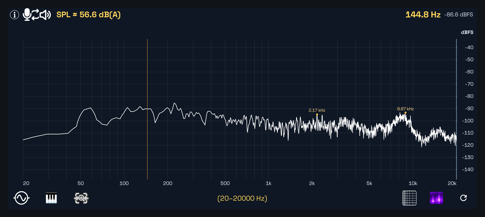
  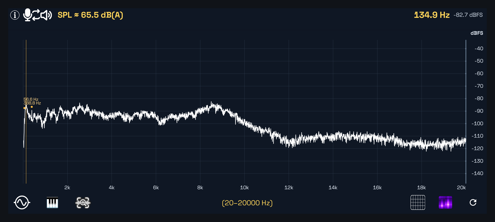

  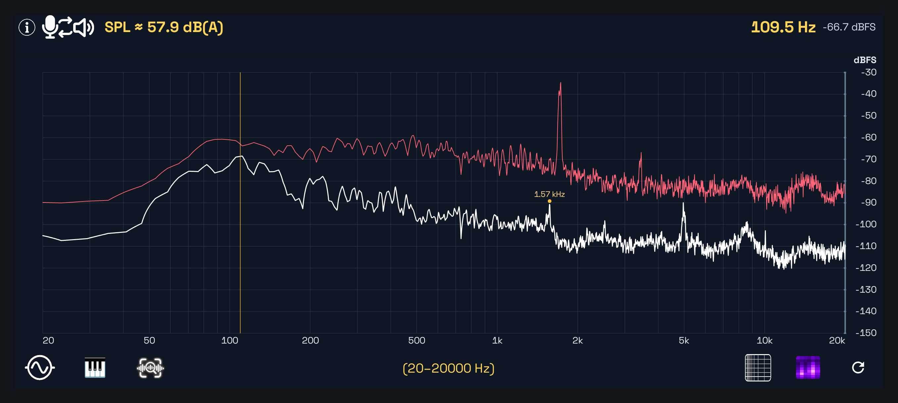
  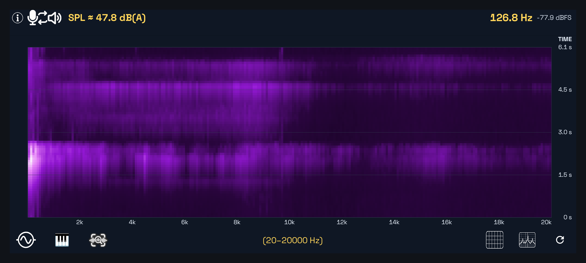

  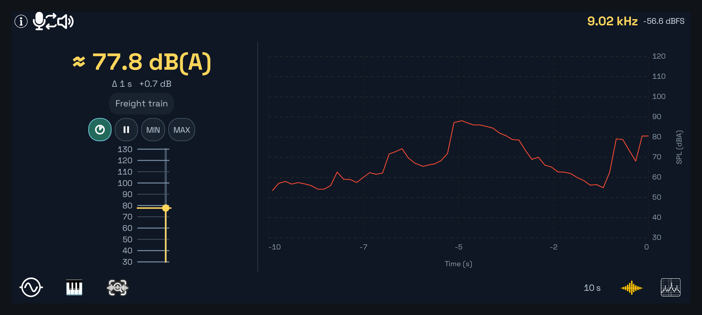
  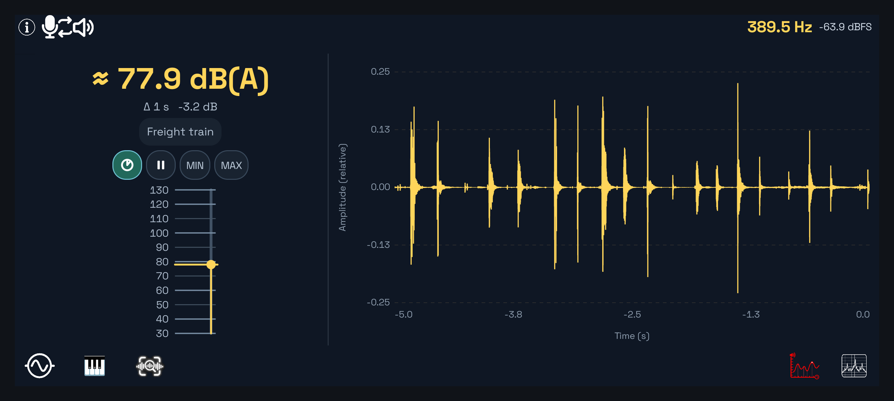

### Sound ID
- Offline sound identification powered by the bundled YAMNet model, with 521 sound classes.
- Shows a leading sound match and alternative predictions.
- Session summary chart showing the most detected sounds and their share of analyzed time.
- Export session summaries as PDF.

  

### My Sound ID
- Record a 5- or 10-second sound sample after a countdown, name it, and save it for future matching.
- Play or pause, rename, delete, and scroll through saved recordings.
- Import WAV recordings.
- Import and export ZIP archives containing recordings, names, and sound profiles.

  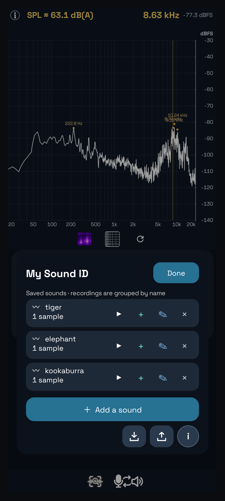

### Tone Generator
- Built-in tone generator with adjustable frequency and volume.
- Sine, square, triangle, and sawtooth waveforms.
- Frequency presets and frequency sweep.
- White noise, pink noise, and DTMF tones.
- Peak-follow mode.
- Add custom frequency presets and delete them with a long press; built-in presets and PEAK are protected.
- Choose sweep direction and durations of 4, 8, 16, or 32 seconds.
- Select LEFT, RIGHT, or STEREO audio output.
- Measure the relative speaker, room, and phone microphone frequency response using an audio sweep.
- View the response curve with estimated dB SPL and export the results as CSV or PDF.

  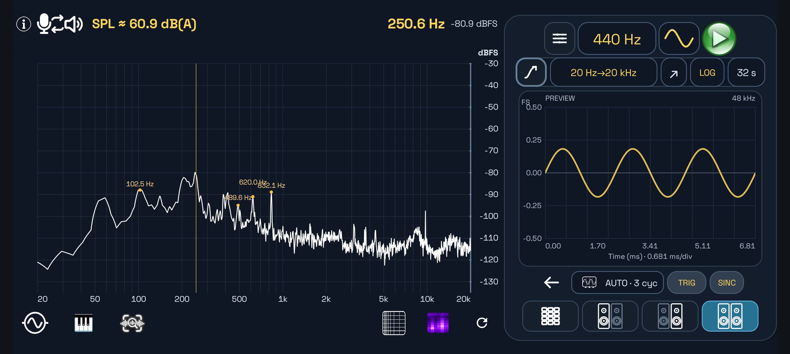
  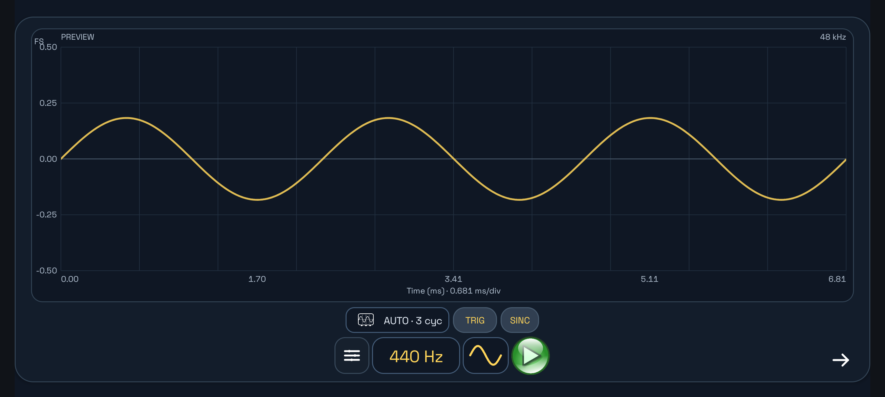

### Piano Keyboard
- Multi-touch piano keyboard with volume, octave, and reverb controls.
- Full-screen keyboard mode.
- Piano samples load in the background, prioritizing the middle octave.

  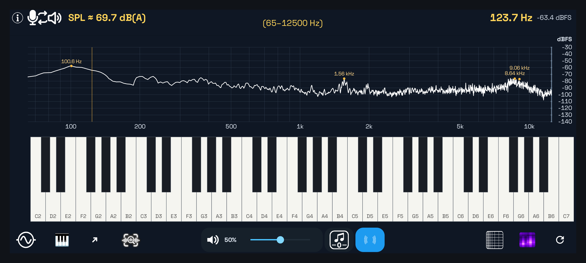
  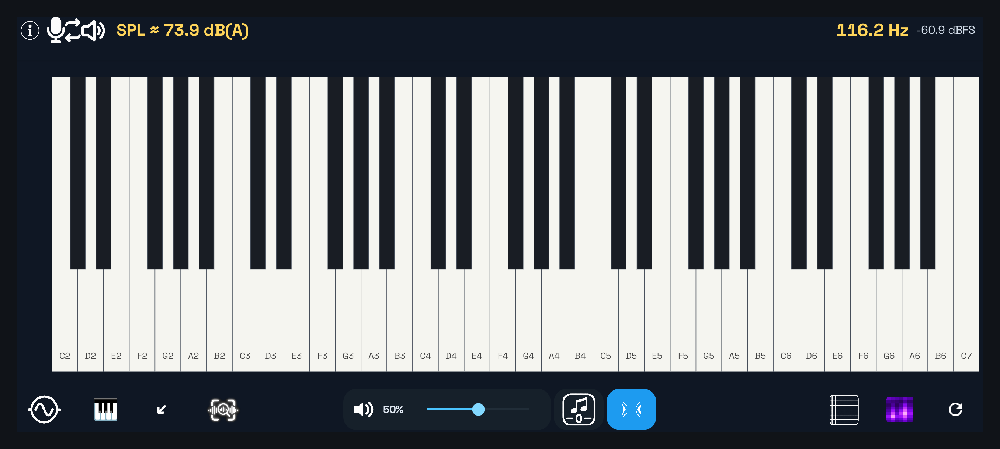

### App Experience
- Audio analysis starts automatically after microphone permission is granted.
- Immersive full-screen interface with icon-based controls.
- Choose the default screen shown at launch.
- Select from available microphones and audio output devices in the app menu.
- Improved layout and stability when switching between app modes and audio devices.

---

## Download & Installation

Spectrum Analyzer2 is a free, open-source native Android application.

**Download the latest APK** from the GitHub Releases page:

[Download Spectrum Analyzer2](https://github.com/ukiddingbitch/SpectrumAnalyzer2/releases)

Alternatively, clone this repository and build the application using Android Studio.

## Source Code

The complete source code is available in this repository under the MIT License.

## Android Compatibility

- **Minimum Android version:** Android 8.0 Oreo (API 26).
- **Target SDK:** API 37 (Android 17).
- **Supported devices:** Android devices running API 26 or later, subject to compatibility testing.

## License

This project is licensed under the MIT License. See the [LICENSE](LICENSE) file for details.
