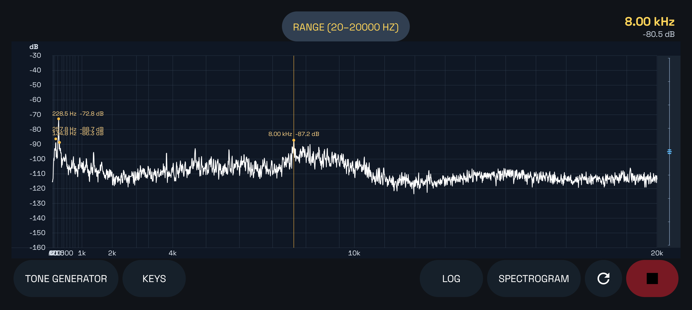
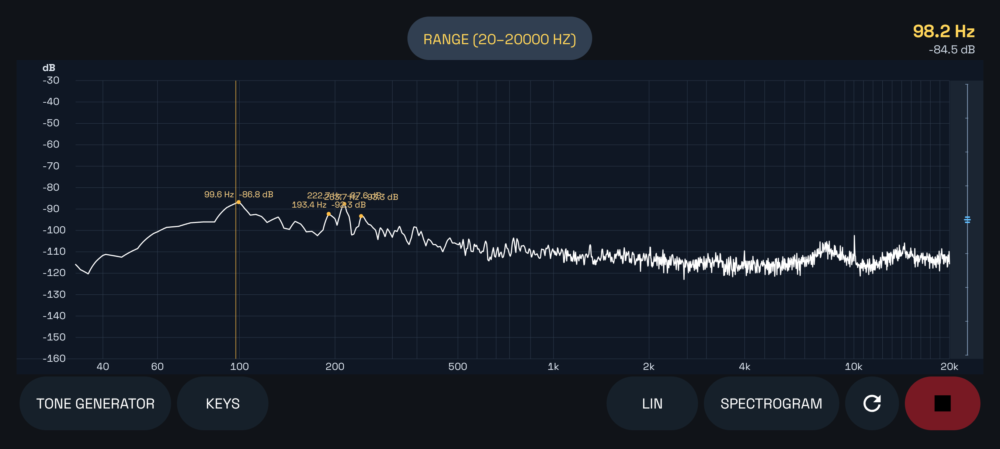
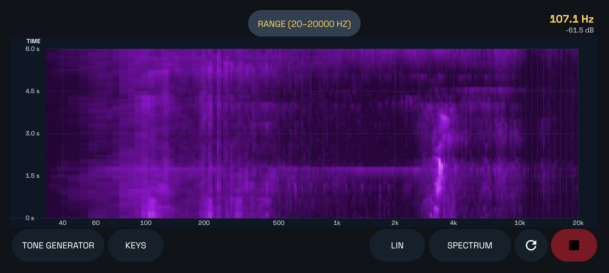
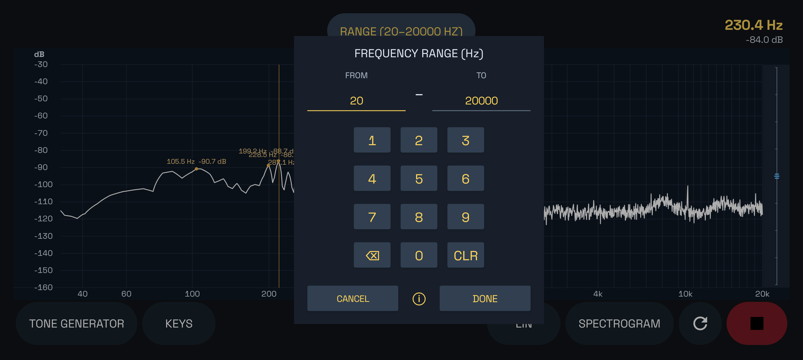
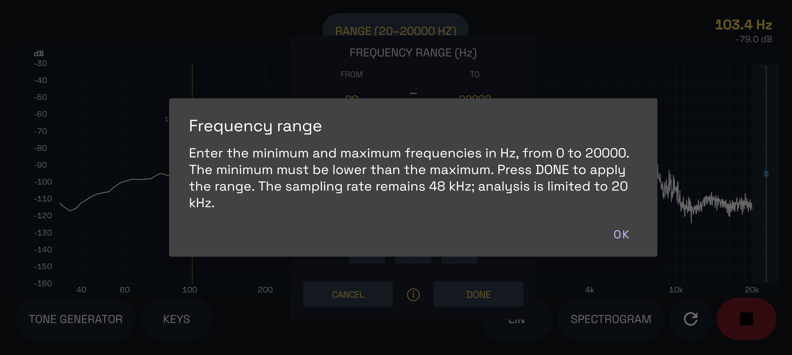
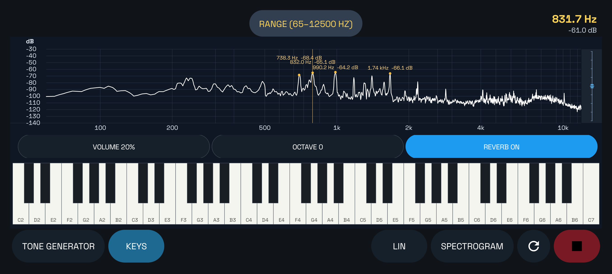
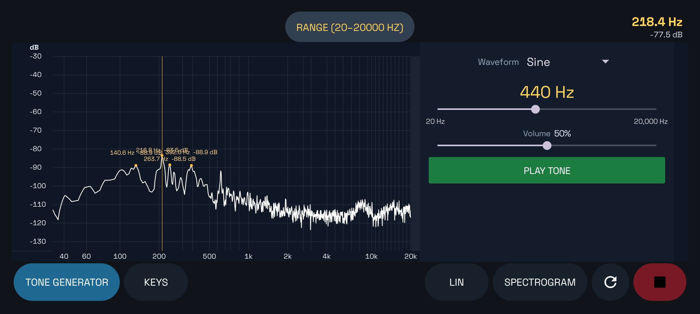

# Spectrum Analyzer2

An Android application developed in Kotlin that visualizes audio frequencies in a spectrum analyzer interface.

## Features

- Audio spectrum visualization.
- Decibel (dB) scale.
- Adjustable display range.
- Pinch-to-zoom gesture support.
- Resettable display range.
- Native Android application built with Kotlin.

## Screenshots

Linear frequency scale.

Logarithmic frequency scale for detailed low-frequency analysis.

Real-time spectrogram showing frequency changes over time.

Frequency range selection.

Frequency range information.

Keys.

Tone generator.

## Source Code

The complete source code is available in this repository.

## Android Compatibility

Minimum Android version: Android 8.0 Oreo (API 26).
Target SDK: API 37 (Android 17).
Supported devices: Android devices running API 26 or later, subject to compatibility testing.

## License

This project is licensed under the MIT License. See the [LICENSE](LICENSE) file for details.
